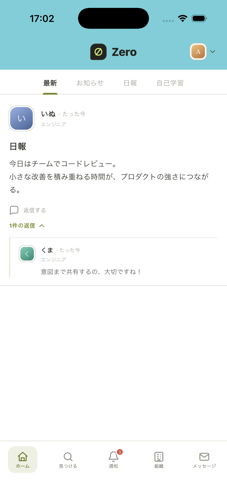
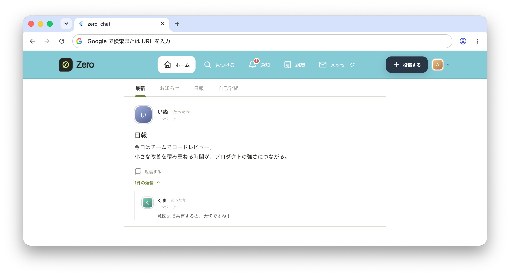
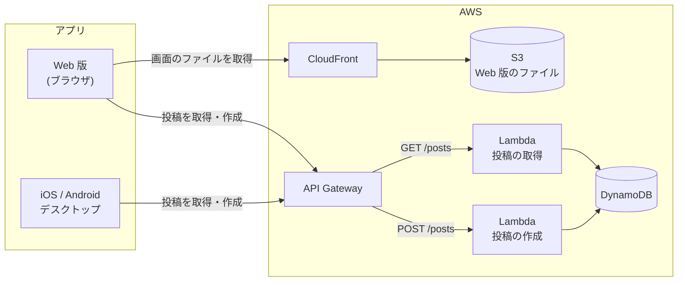

# zero-chat

Flutter によるマルチプラットフォーム開発と AWS サーバーレス構築を学ぶため、自己学習で設計から公開まで行ったチャットアプリです。
1 つのコードで iOS / Android / Web / デスクトップに対応しています。

| iOS | Web |
|:---:|:---:|
|  |  |

## プロジェクト概要

### できること

- タイムラインで投稿を新しい順に表示する (1 回の読み込みで最新 10 件)
- 投稿の種類で絞り込む (最新 / お知らせ / 日報 / 自己学習)
- 投稿への返信を、投稿の下に開いたり閉じたりして表示する
- 投稿する (種類を選び、本文を 180 文字まで入力して送信する。送信後はタイムラインに反映される)
- プロフィール (ユーザー名・役職) を設定する。投稿にはこの名前と役職が表示される (今はアプリを閉じると設定が消える)
- 画面の幅に合わせてレイアウトを切り替える (スマホ: 下のタブバー / PC: 上部のバー)


### 技術スタック

| 領域 | 使っているもの |
|---|---|
| アプリ | Flutter / Dart |
| 状態管理・DI | Riverpod 3 (`flutter_riverpod`) |
| 画面遷移 | go_router |
| 通信 | HTTPS (`http` パッケージ) |
| API | Amazon API Gateway (HTTP API) + AWS Lambda (Python 3.13) |
| データベース | Amazon DynamoDB |
| Web 版の配信 | Amazon S3 + Amazon CloudFront |

### システム構成



アプリの内部は、Flutter 公式が推奨する MVVM + レイヤードアーキテクチャ (UI / Domain / Data) で作っている。
詳しくは [flutter-architecture.md](flutter-architecture.md) を参照。

## ディレクトリ構成

```
zero-chat/
├── Flutter/                         # Flutter アプリ
│   ├── lib/
│   │   ├── main.dart                # 起動処理 (ProviderScope でアプリ全体を包む)
│   │   ├── app.dart                 # MaterialApp.router
│   │   ├── routing/                 # 画面遷移 (go_router)
│   │   ├── ui/                      # UI layer (画面ごと)
│   │   │   ├── core/                #   共通の Widget・テーマ・色
│   │   │   ├── shell/               #   タブバー・上部バーなど画面の外枠
│   │   │   ├── home/                #   ホーム (タイムライン) 画面と ViewModel
│   │   │   ├── compose/             #   投稿画面と ViewModel
│   │   │   ├── profile/             #   プロフィール設定画面
│   │   │   └── placeholder/         #   未実装の画面の仮表示
│   │   ├── domain/
│   │   │   └── models/              # Domain layer (投稿・返信・投稿者などのモデル)
│   │   └── data/                    # Data layer
│   │       ├── repositories/post/   #   投稿の取得・作成 (サーバー版 / 仮データ版)
│   │       └── services/api/        #   サーバーとの通信
│   ├── test/                        # テスト (lib/ と同じ構成)
│   ├── assets/                      # アイコン・ロゴの SVG
│   ├── config/
│   │   └── api.example.json         # API の URL を書く設定ファイルのひな形
│   ├── android/ ios/ web/           # 各プラットフォーム固有の設定
│   └── macos/ windows/ linux/
├── Lambda/                          # AWS Lambda 関数のコード
│   ├── zero-chat-get-posts/         #   投稿取得 API (GET /posts)
│   └── zero-chat-create-post/       #   投稿作成 API (POST /posts)
├── docs/public/                     # 構築手順・仕様のドキュメント
└── flutter-architecture.md          # アプリの設計方針
```

## 動作環境

### 開発環境

| ツール | バージョン |
|---|---|
| Flutter | 3.35.1 (stable) |
| Dart | 3.9.0 |

Dart SDK の条件は `pubspec.yaml` で `^3.9.0` にしている。

### 対応プラットフォーム

| プラットフォーム | 最低バージョン | 動作確認 |
|---|---|---|
| iOS | 13.0 | ✅ iPhone 17 Pro シミュレーター |
| Android | 7.0 (API 24) | - |
| Web | Chrome などのモダンブラウザ | ✅ Chrome |
| macOS | 10.15 | - |
| Windows / Linux | - | - |

最低バージョンは Flutter のプロジェクト作成時の初期値のまま。

## ビルド手順

### 1. 準備

[Flutter](https://docs.flutter.dev/get-started/install) をインストールし、リポジトリを取得して依存パッケージを入れる。
以降のコマンドはすべて `Flutter/` ディレクトリで実行する。

```bash
git clone https://github.com/diapp0227/zero-chat.git
cd zero-chat/Flutter
flutter pub get
```

### 2. 起動する

#### 仮のデータで起動する

サーバーがなくても、アプリに組み込んだ仮の投稿データで動かせる。
投稿した内容はアプリの中 (メモリ) にだけ保存され、アプリを閉じると消える。

```bash
flutter run
```

#### サーバーにつないで起動する

API の URL は `config/api.json` に書き、ビルド時に渡す。
このファイルは公開しないよう git の管理対象外にしている。

1. `config/api.example.json` をコピーして `config/api.json` を作る
2. `<API ID>` を実際の値にする (URL の末尾に `/` は付けない)
3. `--dart-define-from-file` を付けて起動する

```bash
cp config/api.example.json config/api.json
flutter run --dart-define-from-file=config/api.json
```

Web 版をローカルで動かすときは、API の CORS 設定で許可しているポート (8080) に固定する。

```bash
flutter run -d chrome --web-port 8080 --dart-define-from-file=config/api.json
```

※ `--dart-define` の値はアプリに埋め込まれるため、秘密の情報は渡さない。

※ API 自体の作り方は、投稿の取得は [posts-api-aws.md](docs/public/posts-api-aws.md)、
投稿の作成は [create-post-api-aws.md](docs/public/create-post-api-aws.md) を参照。

### 3. テストする

```bash
flutter test
flutter analyze
```

テストは通信しないので、API がなくても実行できる。

### 4. リリースビルド

サーバーにつなぐ場合は、どのプラットフォームでも `--dart-define-from-file=config/api.json` を付ける。

| プラットフォーム | コマンド | 出力先 |
|---|---|---|
| Web | `flutter build web --release --dart-define-from-file=config/api.json` | `build/web/` |
| iOS | `flutter build ios --release --dart-define-from-file=config/api.json` | `build/ios/` |
| Android | `flutter build apk --release --dart-define-from-file=config/api.json` | `build/app/outputs/flutter-apk/` |
| macOS | `flutter build macos --release --dart-define-from-file=config/api.json` | `build/macos/` |

Web 版を AWS (S3 + CloudFront) に公開する手順は [deploy-web-aws.md](docs/public/deploy-web-aws.md) を参照。
