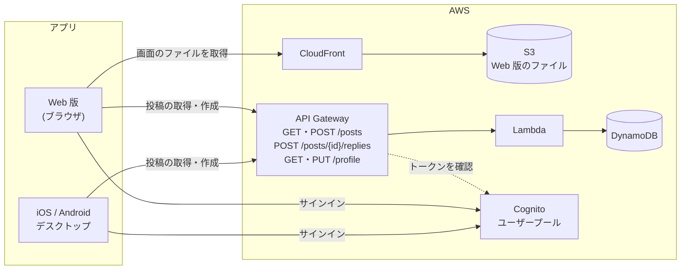

# zero-chat

Flutter によるマルチプラットフォーム開発と AWS サーバーレス構築を学ぶため、自己学習で設計から公開まで行ったチャットアプリです。
1 つのコードで iOS / Android / Web / デスクトップに対応しています。

| iOS | Web |
|:---:|:---:|
|  |  |

## プロジェクト概要

### できること

- メールアドレスとパスワードでサインアップ (メールで届く 6 桁の確認コードで確認) ・サインインする。
  前回のサインインは、次にアプリを開いたときも残る
- 投稿の読み書きはサインインした人だけができる (API がトークンを確かめる)
- タイムラインで投稿を新しい順に表示する。下までスクロールすると、続きの 10 件を読み込む
- 投稿の種類で絞り込む (最新 / お知らせ / 日報 / 自己学習)
- 投稿に返信する。返信は投稿の下に開いたり閉じたりして表示する
- 投稿する (種類を選び、本文を 180 文字まで入力して送信する。送信後はタイムラインに反映される)
- プロフィール (ユーザー名・役職) をサインアップ時に入力し、プロフィール設定画面で変更する。アバターの色 (カラー1・カラー2) も一緒に保存する。
  サーバーにサインインした人ごとに保存され、投稿にはこの名前と役職が表示される
- 画面の幅に合わせてレイアウトを切り替える (スマホ: 下のタブバー / PC: 上部のバー)


### 技術スタック

#### アプリ (Flutter)

| 領域 | 使っているもの |
|---|---|
| 言語・フレームワーク | Flutter / Dart |
| 状態管理・DI | Riverpod 3 (`flutter_riverpod`) |
| 画面遷移 | `go_router` |
| API との通信 | `http` (HTTPS) |
| 認証 (Cognito とのやり取り) | Amplify Flutter (`amplify_flutter`・`amplify_auth_cognito`) |
| アイコン・ロゴの表示 | `flutter_svg` |

#### サーバー (AWS)

| 領域 | 使っているサービス |
|---|---|
| 認証 | Amazon Cognito (ユーザープール) |
| API | Amazon API Gateway (HTTP API・JWT オーソライザー) |
| API の処理 | AWS Lambda (Python 3.13) |
| データベース | Amazon DynamoDB |
| Web 版の配信 | Amazon S3 + Amazon CloudFront |

### システム構成



アプリの内部は、Flutter 公式が推奨する MVVM + レイヤードアーキテクチャ (UI / Domain / Data) で作っている。
詳しくは [flutter-architecture.md](flutter-architecture.md) を参照。

## ディレクトリ構成

```
zero-chat/
├── Flutter/                         # Flutter アプリ
│   ├── lib/
│   │   ├── main.dart                # 起動処理 (Amplify の準備・前回のサインインの確認・ProviderScope)
│   │   ├── app.dart                 # MaterialApp.router
│   │   ├── routing/                 # 画面遷移 (go_router)
│   │   ├── ui/                      # UI layer (画面ごと)
│   │   │   ├── core/                #   共通の Widget・テーマ・色
│   │   │   ├── shell/               #   タブバー・上部バーなど画面の外枠
│   │   │   ├── auth/                #   サインアップ・サインイン画面と ViewModel・サインイン状態
│   │   │   ├── home/                #   ホーム (タイムライン) 画面と ViewModel
│   │   │   ├── compose/             #   投稿画面と ViewModel
│   │   │   ├── profile/             #   プロフィール設定画面・ログイン中の人のプロフィール
│   │   │   └── placeholder/         #   未実装の画面の仮表示
│   │   ├── domain/
│   │   │   └── models/              # Domain layer (投稿・返信・投稿者などのモデル)
│   │   └── data/                    # Data layer
│   │       ├── repositories/post/   #   投稿の取得・作成 (サーバー版 / 仮データ版)
│   │       ├── repositories/auth/   #   サインアップ・サインイン (Cognito 版 / 仮の認証版)
│   │       ├── repositories/profile/ #  自分のプロフィールの取得・保存 (サーバー版 / 仮データ版)
│   │       └── services/api/        #   サーバーとの通信
│   ├── test/                        # テスト (lib/ と同じ構成)
│   ├── assets/                      # アイコン・ロゴの SVG
│   ├── config/
│   │   └── api.example.json         # API の URL と Cognito の ID を書く設定ファイルのひな形
│   ├── android/ ios/ web/           # 各プラットフォーム固有の設定
│   └── macos/ windows/ linux/
├── Lambda/                          # AWS Lambda 関数のコード
│   ├── zero-chat-get-posts/         #   投稿取得 API (GET /posts)
│   ├── zero-chat-create-post/       #   投稿作成 API (POST /posts)
│   ├── zero-chat-create-reply/      #   返信作成 API (POST /posts/{id}/replies)
│   ├── zero-chat-get-profile/       #   プロフィール取得 API (GET /profile)
│   └── zero-chat-update-profile/    #   プロフィール更新 API (PUT /profile)
├── docs/public/                     # 構築手順・仕様のドキュメント
└── flutter-architecture.md          # アプリの設計方針
```

## 動作環境

### 開発環境

| ツール | バージョン |
|---|---|
| Flutter | 3.35.1 (stable) |
| Dart | 3.9.0 |

Dart SDK の条件は `pubspec.yaml` で `^3.9.0` にしている。

### 対応プラットフォーム

| プラットフォーム | 最低バージョン | 動作確認 |
|---|---|---|
| iOS | 13.0 | ✅ iPhone 17 Pro シミュレーター (Cognito でのサインインまで確認) |
| Android | 7.0 (API 24) | - |
| Web | Chrome などのモダンブラウザ | ✅ Chrome (Cognito でのサインインまで確認) |
| macOS | 10.15 | - (※) |
| Windows / Linux | - | - |

最低バージョンは Flutter のプロジェクト作成時の初期値のまま。Amplify Flutter の条件 (iOS 13 以上・Android API 24 以上) も満たしている。

※ macOS アプリでは、Amplify がトークンを保存するためのキーチェーンの設定 (Keychain Sharing) をしていないため、サインインは動かない見込み。

## ビルド手順

### 1. 準備

[Flutter](https://docs.flutter.dev/get-started/install) をインストールし、リポジトリを取得して依存パッケージを入れる。
以降のコマンドはすべて `Flutter/` ディレクトリで実行する。

```bash
git clone https://github.com/diapp0227/zero-chat.git
cd zero-chat/Flutter
flutter pub get
```

### 2. 起動する

#### 仮のデータで起動する

サーバーがなくても、アプリに組み込んだ仮の投稿データと仮の認証で動かせる。
投稿した内容はアプリの中 (メモリ) にだけ保存され、アプリを閉じると消える。

- 起動すると、まずサインイン画面が出る。サインアップすると確認コードの入力に進むので、`123456` を入れる
- 仮の認証で作ったアカウントもアプリを閉じると消えるので、起動するたびにサインアップし直す

```bash
flutter run
```

#### サーバーにつないで起動する

API の URL と Cognito の ID は `config/api.json` に書き、ビルド時に渡す。
このファイルは公開しないよう git の管理対象外にしている。

1. `config/api.example.json` をコピーして `config/api.json` を作る
2. 次の 3 つを実際の値にする
   - `API_BASE_URL`: API の URL (`<API ID>` を置き換える。末尾に `/` は付けない)
   - `COGNITO_USER_POOL_ID`: Cognito のユーザープール ID
   - `COGNITO_CLIENT_ID`: Cognito のアプリケーションクライアント ID
3. `--dart-define-from-file` を付けて起動する

```bash
cp config/api.example.json config/api.json
flutter run --dart-define-from-file=config/api.json
```

Web 版をローカルで動かすときは、API の CORS 設定で許可しているポート (8080) に固定する。

```bash
flutter run -d chrome --web-port 8080 --dart-define-from-file=config/api.json
```

※ `--dart-define` の値はアプリに埋め込まれるため、秘密の情報は渡さない (API の URL と Cognito の ID は秘密の値ではない)。

※ API はサインインした人のトークンがないと 401 を返す。API の URL だけ渡して Cognito の ID を渡さないと、
仮の認証で動いてトークンが付かないため、投稿を読めない。

※ AWS 側の作り方は次を参照。

| 内容 | 手順書 |
|---|---|
| 投稿の取得 API | [posts-api-aws.md](docs/public/posts-api-aws.md) |
| 投稿の作成 API | [create-post-api-aws.md](docs/public/create-post-api-aws.md) |
| サインアップ・サインイン (Cognito) | [cognito-auth-aws.md](docs/public/cognito-auth-aws.md) |
| API の JWT 認証 | [api-jwt-auth-aws.md](docs/public/api-jwt-auth-aws.md) |
| プロフィールの取得・更新 API | [profile-api-aws.md](docs/public/profile-api-aws.md) |
| 返信 API・投稿の author のカラー | [reply-api-aws.md](docs/public/reply-api-aws.md) |
| 投稿・返信を最新のプロフィールで表示 | [latest-author-aws.md](docs/public/latest-author-aws.md) |
| タイムラインのページング | [paging-aws.md](docs/public/paging-aws.md) |

### 3. テストする

```bash
flutter test
flutter analyze
```

テストは通信しないので、API や Cognito がなくても実行できる。

### 4. リリースビルド

サーバーにつなぐ場合は、どのプラットフォームでも `--dart-define-from-file=config/api.json` を付ける。

| プラットフォーム | コマンド | 出力先 |
|---|---|---|
| Web | `flutter build web --release --dart-define-from-file=config/api.json` | `build/web/` |
| iOS | `flutter build ios --release --dart-define-from-file=config/api.json` | `build/ios/` |
| Android | `flutter build apk --release --dart-define-from-file=config/api.json` | `build/app/outputs/flutter-apk/` |
| macOS | `flutter build macos --release --dart-define-from-file=config/api.json` | `build/macos/` |

Web 版を AWS (S3 + CloudFront) に公開する手順は [deploy-web-aws.md](docs/public/deploy-web-aws.md) を参照。
