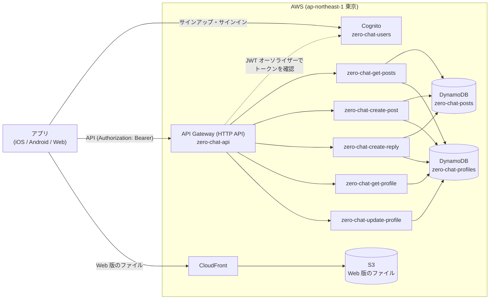

# AWS の構築手順 (一から作る)

zero-chat が使う AWS のリソースを、何もない状態から作る手順。上から順に進めれば、アプリ (iOS・Android・Web) が動く状態になる。

## 目次

- [全体の構成](#全体の構成)
- [作るリソース](#作るリソース)
- [0. 前提](#0-前提)
  - [CLI で作る場合](#cli-で作る場合)
- [1. Cognito のユーザープールを作る](#1-cognito-のユーザープールを作る)
  - [1-1. ユーザープールとアプリケーションクライアントを作る](#1-1-ユーザープールとアプリケーションクライアントを作る)
  - [1-2. 作成直後の設定を直す](#1-2-作成直後の設定を直す)
  - [1-3. ID を控える](#1-3-id-を控える)
  - [1-4. 確かめる (任意)](#1-4-確かめる-任意)
- [2. DynamoDB のテーブルを作る](#2-dynamodb-のテーブルを作る)
  - [2-1. 投稿のテーブル `zero-chat-posts`](#2-1-投稿のテーブル-zero-chat-posts)
  - [2-2. プロフィールのテーブル `zero-chat-profiles`](#2-2-プロフィールのテーブル-zero-chat-profiles)
- [3. Lambda 関数を作る](#3-lambda-関数を作る)
  - [3-1. 関数を作成する](#3-1-関数を作成する)
  - [3-2. 環境変数を設定する (コードより先に)](#3-2-環境変数を設定する-コードより先に)
  - [3-3. DynamoDB の権限を付ける](#3-3-dynamodb-の権限を付ける)
  - [3-4. コードを貼り付けてデプロイする](#3-4-コードを貼り付けてデプロイする)
  - [3-5. テストする](#3-5-テストする)
  - [3-6. CLI で行う場合 (3-1〜3-4 をまとめて行う)](#3-6-cli-で行う場合-3-13-4-をまとめて行う)
- [4. API Gateway を作る](#4-api-gateway-を作る)
  - [4-1. HTTP API を作る](#4-1-http-api-を作る)
  - [4-2. ルートを足す](#4-2-ルートを足す)
  - [4-3. JWT オーソライザーを作り、すべてのルートに付ける](#4-3-jwt-オーソライザーを作りすべてのルートに付ける)
  - [4-4. CORS を設定する (Web 版から呼ぶため)](#4-4-cors-を設定する-web-版から呼ぶため)
  - [4-5. 書き込みに送信回数の上限を付ける (スロットリング)](#4-5-書き込みに送信回数の上限を付ける-スロットリング)
  - [4-6. CLI で行う場合 (4-1〜4-5 をまとめて行う)](#4-6-cli-で行う場合-4-14-5-をまとめて行う)
  - [4-7. 確かめる](#4-7-確かめる)
- [5. アプリをつなぐ](#5-アプリをつなぐ)
- [6. Web 版を公開する (S3 + CloudFront)](#6-web-版を公開する-s3--cloudfront)
  - [6-1. S3 バケットを作る](#6-1-s3-バケットを作る)
  - [6-2. バケットを非公開にする](#6-2-バケットを非公開にする)
  - [6-3. CloudFront の OAC を作る](#6-3-cloudfront-の-oac-を作る)
  - [6-4. CloudFront のディストリビューションを作る](#6-4-cloudfront-のディストリビューションを作る)
  - [6-5. CloudFront からだけ読めるバケットポリシーを付ける](#6-5-cloudfront-からだけ読めるバケットポリシーを付ける)
  - [6-6. API の CORS に公開 URL を足す](#6-6-api-の-cors-に公開-url-を足す)
  - [6-7. ビルドしてアップロードする](#6-7-ビルドしてアップロードする)
  - [6-8. 確かめる](#6-8-確かめる)
- [7. 更新するとき](#7-更新するとき)
  - [Lambda のコードを直したとき](#lambda-のコードを直したとき)
  - [Web 版を出し直すとき](#web-版を出し直すとき)
  - [API とアプリの両方を変えるとき](#api-とアプリの両方を変えるとき)
- [8. 削除するとき](#8-削除するとき)
- [うまくいかないとき](#うまくいかないとき)
- [公開範囲と今後の課題](#公開範囲と今後の課題)

各リソースの細かい仕様 (項目の意味・API のリクエストとレスポンス・設計の理由) は、次のドキュメントにある。

| 種類 | ドキュメント |
|---|---|
| DynamoDB のテーブル定義 | [table/posts-table.md](table/posts-table.md)・[table/profiles-table.md](table/profiles-table.md) |
| Lambda 関数の仕様 | [lambda/get-posts.md](lambda/get-posts.md)・[lambda/create-post.md](lambda/create-post.md)・[lambda/create-reply.md](lambda/create-reply.md)・[lambda/profile.md](lambda/profile.md) |
| 認証の設定 | [auth/cognito.md](auth/cognito.md)・[auth/jwt-authorizer.md](auth/jwt-authorizer.md) |
| 実際の ID・URL (非公開) | [aws-resources.md](../private/aws-resources.md) |

## 全体の構成



## 作るリソース

| 順番 | サービス | 名前 | 用途 |
|---|---|---|---|
| 1 | Cognito ユーザープール | `zero-chat-users` | サインアップ・サインイン |
| 1 | Cognito アプリケーションクライアント | `zero-chat-app` | アプリが Cognito を呼ぶときの窓口 |
| 2 | DynamoDB テーブル | `zero-chat-posts` | 投稿と返信 |
| 2 | DynamoDB テーブル | `zero-chat-profiles` | プロフィール (名前・役職・カラー) |
| 3 | Lambda 関数 | `zero-chat-get-posts` | `GET /posts` |
| 3 | Lambda 関数 | `zero-chat-create-post` | `POST /posts` |
| 3 | Lambda 関数 | `zero-chat-create-reply` | `POST /posts/{id}/replies` |
| 3 | Lambda 関数 | `zero-chat-get-profile` | `GET /profile` |
| 3 | Lambda 関数 | `zero-chat-update-profile` | `PUT /profile` |
| 4 | API Gateway (HTTP API) | `zero-chat-api` | 5 本のルート、JWT オーソライザー `zero-chat-cognito` |
| 6 | S3 バケット | (アカウントごとの名前) | Web 版のファイル (非公開) |
| 6 | CloudFront | ディストリビューション・OAC | Web 版の HTTPS 配信 |

---

## 0. 前提

- **リージョンはすべて `ap-northeast-1` (東京)** にそろえる。コンソール右上のリージョンを確かめてから作業する
  - Lambda は、自分と同じリージョンの DynamoDB テーブルを読み書きする。テーブルと Lambda のリージョンがずれると動かない
  - AWS Organizations の組織に入っているアカウントでは、組織の SCP (サービスコントロールポリシー) で
    S3 や DynamoDB などの操作が拒否されることがある。使うアカウントで、これらのサービスが使えることを先に確かめる
- AWS アカウントは**無料プラン**を想定している。今回のサービスはどれも毎月の無料利用枠があり、開発中のアクセス量ならクレジットはほぼ減らない
  (クレジットの残高と期限は、Billing and Cost Management コンソールのホームで確認できる)
- 手順 6 (Web 版の公開) では AWS CLI v2 を使う。`aws login` で、作業するアカウントにログインしておく

```bash
aws login
aws sts get-caller-identity   # 作業するアカウントか確認
```

- 手順の中の `<アカウントID>` は、ハイフンなしの 12 桁の数字 (コンソール右上のアカウント名をクリックすると表示される)

### CLI で作る場合

各手順に、コンソールの操作と同じことをする AWS CLI のコマンドを「**CLI で行う場合**」として書いてある。
コマンドは、リポジトリのルート (`zero-chat/`) で、次のシェル変数を設定してから実行する前提。

```bash
export AWS_REGION=ap-northeast-1
export ACCOUNT_ID=$(aws sts get-caller-identity --query Account --output text)
```

- 前の手順で作った ID (`USER_POOL_ID`・`CLIENT_ID`・`API_ID` など) は、その手順のコマンドで変数に入れる。
  ターミナルを開き直したときは、[aws-resources.md](../private/aws-resources.md) に控えた値で `export` し直す
- コンソールでは自動で行われるが、CLI では自分で行う必要があるもの (Lambda の実行ロールの作成、API Gateway から Lambda を呼ぶ権限、
  API のステージの作成) も、コマンドに含めてある
- 同じものを 2 回作ろうとするとエラーになる (名前がぶつかる)。やり直すときは、先に「8. 削除するとき」で消す

---

## 1. Cognito のユーザープールを作る

設定の意味と理由は [auth/cognito.md](auth/cognito.md) を参照。

### 1-1. ユーザープールとアプリケーションクライアントを作る

**Amazon Cognito → ユーザープール → ユーザープールを作成**

| 項目 | 値 |
|---|---|
| アプリケーションタイプ | **シングルページアプリケーション (SPA)** |
| アプリケーションに名前を付ける | `zero-chat-app` |
| サインイン識別子のオプション | **メールアドレス** だけにチェック |
| 自己登録 | **自己登録を有効化** にチェック |
| サインアップのための必須属性 | `email` (サインイン識別子にメールアドレスを選ぶと自動で入る) |
| リターン URL | 空のまま |

- サインイン識別子と必須属性は、**作成後に変更できない**。間違えたらユーザープールを作り直す
- 「ユーザーディレクトリを作成する」を押すと、ユーザープールとアプリケーションクライアントがまとめてできる
- ユーザープールの名前は自動で付くので、**ユーザープール → 名前を変更** で `zero-chat-users` にしておく
  (変えられない場合はそのままでよい。アプリが使うのは名前ではなく ID)

### 1-2. 作成直後の設定を直す

| 場所 | 項目 | 値 |
|---|---|---|
| 認証方法 → パスワードポリシー | モード | **カスタム** |
| 認証方法 → パスワードポリシー | 最小文字数 | 8 |
| 認証方法 → パスワードポリシー | パスワードの要件 | **すべてのチェックを外す** |
| サインアップ | Cognito が支援する検証と確認 | **E メールメッセージを送信、E メールアドレスを検証** |
| 設定 → 機能プラン | プラン | **Lite** (作成直後は Essentials のことがある) |
| アプリケーション → アプリケーションクライアント → `zero-chat-app` | クライアントシークレット | **なし** (表示されていないこと) |
| 同上 | 認証フロー | `ALLOW_USER_SRP_AUTH` と `ALLOW_REFRESH_TOKEN_AUTH` |

- パスワードポリシーは、作成直後は「大文字・小文字・数字・記号をそれぞれ含む」になっているので、「編集」で上のように変える
- `ALLOW_USER_PASSWORD_AUTH` は付けない

#### CLI で行う場合 (1-1・1-2 をまとめて行う)

```bash
# ユーザープール (メールアドレスでサインイン・自己登録・8 文字以上だけのパスワード・確認コードはメールで・Lite プラン)
export USER_POOL_ID=$(aws cognito-idp create-user-pool --region "$AWS_REGION" \
  --pool-name zero-chat-users \
  --username-attributes email \
  --auto-verified-attributes email \
  --schema Name=email,AttributeDataType=String,Required=true,Mutable=true \
  --policies 'PasswordPolicy={MinimumLength=8,RequireUppercase=false,RequireLowercase=false,RequireNumbers=false,RequireSymbols=false}' \
  --admin-create-user-config AllowAdminCreateUserOnly=false \
  --user-pool-tier LITE \
  --query UserPool.Id --output text)

# アプリケーションクライアント (シークレットなし・SRP とリフレッシュだけ・ユーザー存在エラーの防止)
export CLIENT_ID=$(aws cognito-idp create-user-pool-client --region "$AWS_REGION" \
  --user-pool-id "$USER_POOL_ID" \
  --client-name zero-chat-app \
  --no-generate-secret \
  --explicit-auth-flows ALLOW_USER_SRP_AUTH ALLOW_REFRESH_TOKEN_AUTH \
  --prevent-user-existence-errors ENABLED \
  --query UserPoolClient.ClientId --output text)

echo "USER_POOL_ID=$USER_POOL_ID CLIENT_ID=$CLIENT_ID"   # 1-3 で控える
```

- `--user-pool-tier` (機能プラン) が使えない古い CLI では、このオプションを外して作り、コンソールで Lite に変える
- 確認コードのメールは、既定で Cognito から送られる (`--email-configuration` は指定しない)
- ⚠️ 作った後にクライアントの設定を `update-user-pool-client` で変えるときは、**指定しなかった項目が初期値に戻る**。
  今の設定を `describe-user-pool-client` で読み出し、すべての項目を指定して変える

### 1-3. ID を控える

| 値 | 場所 |
|---|---|
| ユーザープール ID (`ap-northeast-1_xxxxxxxxx`) | ユーザープールの「概要」 |
| アプリケーションクライアント ID | アプリケーションクライアントの一覧 |

[aws-resources.md](../private/aws-resources.md) に書いておく (公開のドキュメントには書かない)。手順 4 と 5 で使う。
CLI で作った場合は、`USER_POOL_ID`・`CLIENT_ID` の変数に入っている。

### 1-4. 確かめる (任意)

```bash
# サインアップ (確認コードがメールで届く)。メールアドレスは自分が受信できるものにする
aws cognito-idp sign-up --region ap-northeast-1 \
  --client-id <クライアントID> \
  --username you@example.com --password 'Passw0rd!' \
  --user-attributes Name=email,Value=you@example.com

# 届いたコードで確認する
aws cognito-idp confirm-sign-up --region ap-northeast-1 \
  --client-id <クライアントID> \
  --username you@example.com --confirmation-code 123456
```

**ユーザープール → ユーザー** で「確認ステータス」が「確認済み」になれば成功。テスト用のユーザーは不要なら削除する。

---

## 2. DynamoDB のテーブルを作る

### 2-1. 投稿のテーブル `zero-chat-posts`

項目と属性の定義は [table/posts-table.md](table/posts-table.md) を参照。

**DynamoDB → テーブル → テーブルの作成**

| 項目 | 値 |
|---|---|
| テーブル名 | `zero-chat-posts` |
| パーティションキー | `id` (数値) |
| ソートキー | なし |
| テーブル設定 | 設定をカスタマイズ → キャパシティモード **オンデマンド** |

ステータスが「アクティブ」になったら、**「インデックス」タブ → インデックスの作成** で GSI を 2 つ作る。

| インデックス名 | パーティションキー | ソートキー | 属性の射影 |
|---|---|---|---|
| `feed-postedAt-index` | `feed` (文字列) | `postedAt` (文字列) | すべて |
| `category-postedAt-index` | `category` (文字列) | `postedAt` (文字列) | すべて |

- インデックス名はキー名から自動で入る。**キー名を打ち間違えるとインデックス名もずれる**ので、上の表と完全に一致しているか確かめる (大文字・小文字も区別される)
- インデックス名は後から変えられない。間違えたら作り直す
- 射影は「すべて」にする。そうしないと `text` や `author` が取得の結果に含まれない

最後に、**投稿の番号を数える項目**を作る。**「項目を探索」→ 項目を作成 → JSON ビュー** (「DynamoDB JSON を表示」はオフ):

```json
{ "id": 0, "lastPostId": 0 }
```

- 投稿の作成 API が、この値を 1 ずつ増やして投稿の番号にする。**この項目を消さない**
- 手で投稿を足すときは、`id` を `lastPostId` より大きくし、`lastPostId` もその `id` に合わせる

#### CLI で行う場合

```bash
# テーブルと GSI 2 つ (オンデマンド)
aws dynamodb create-table --region "$AWS_REGION" \
  --table-name zero-chat-posts \
  --attribute-definitions \
    AttributeName=id,AttributeType=N \
    AttributeName=feed,AttributeType=S \
    AttributeName=category,AttributeType=S \
    AttributeName=postedAt,AttributeType=S \
  --key-schema AttributeName=id,KeyType=HASH \
  --billing-mode PAY_PER_REQUEST \
  --global-secondary-indexes '[
    {"IndexName": "feed-postedAt-index",
     "KeySchema": [{"AttributeName": "feed", "KeyType": "HASH"}, {"AttributeName": "postedAt", "KeyType": "RANGE"}],
     "Projection": {"ProjectionType": "ALL"}},
    {"IndexName": "category-postedAt-index",
     "KeySchema": [{"AttributeName": "category", "KeyType": "HASH"}, {"AttributeName": "postedAt", "KeyType": "RANGE"}],
     "Projection": {"ProjectionType": "ALL"}}
  ]'
aws dynamodb wait table-exists --region "$AWS_REGION" --table-name zero-chat-posts

# 投稿の番号を数える項目 (すでにあれば作らない)
aws dynamodb put-item --region "$AWS_REGION" \
  --table-name zero-chat-posts \
  --item '{"id": {"N": "0"}, "lastPostId": {"N": "0"}}' \
  --condition-expression 'attribute_not_exists(id)'
```

- `--attribute-definitions` には、テーブルとインデックスの**キーに使う属性だけ**を書く (`text` などは書かない)
- テーブルと一緒に作った GSI は、テーブルが「アクティブ」になると使える

### 2-2. プロフィールのテーブル `zero-chat-profiles`

項目と属性の定義は [table/profiles-table.md](table/profiles-table.md) を参照。

| 項目 | 値 |
|---|---|
| テーブル名 | `zero-chat-profiles` |
| パーティションキー | `userId` (文字列) |
| ソートキー | なし |
| テーブル設定 | 設定をカスタマイズ → キャパシティモード **オンデマンド** |

インデックスは作らない。`userId` には、Cognito のユーザーの `sub` が入る (API がトークンから決める)。

#### CLI で行う場合

```bash
aws dynamodb create-table --region "$AWS_REGION" \
  --table-name zero-chat-profiles \
  --attribute-definitions AttributeName=userId,AttributeType=S \
  --key-schema AttributeName=userId,KeyType=HASH \
  --billing-mode PAY_PER_REQUEST
aws dynamodb wait table-exists --region "$AWS_REGION" --table-name zero-chat-profiles
```

---

## 3. Lambda 関数を作る

5 つの関数を、どれも同じ手順で作る。関数ごとの違い (コード・環境変数・権限) は表のとおり。

| 関数名 | コード | 環境変数 | 仕様 |
|---|---|---|---|
| `zero-chat-get-posts` | [lambda_function.py](../../Lambda/zero-chat-get-posts/lambda_function.py) | `TABLE_NAME` = `zero-chat-posts`<br>`PROFILES_TABLE_NAME` = `zero-chat-profiles` | [lambda/get-posts.md](lambda/get-posts.md) |
| `zero-chat-create-post` | [lambda_function.py](../../Lambda/zero-chat-create-post/lambda_function.py) | `TABLE_NAME` = `zero-chat-posts`<br>`PROFILES_TABLE_NAME` = `zero-chat-profiles` | [lambda/create-post.md](lambda/create-post.md) |
| `zero-chat-create-reply` | [lambda_function.py](../../Lambda/zero-chat-create-reply/lambda_function.py) | `POSTS_TABLE_NAME` = `zero-chat-posts`<br>`PROFILES_TABLE_NAME` = `zero-chat-profiles` | [lambda/create-reply.md](lambda/create-reply.md) |
| `zero-chat-get-profile` | [lambda_function.py](../../Lambda/zero-chat-get-profile/lambda_function.py) | `TABLE_NAME` = `zero-chat-profiles` | [lambda/profile.md](lambda/profile.md) |
| `zero-chat-update-profile` | [lambda_function.py](../../Lambda/zero-chat-update-profile/lambda_function.py) | `TABLE_NAME` = `zero-chat-profiles` | [lambda/profile.md](lambda/profile.md) |

### 3-1. 関数を作成する

**Lambda → 関数 → 関数の作成 → 一から作成**

| 項目 | 値 |
|---|---|
| 関数名 | 上の表の関数名 |
| ランタイム | Python 3.13 |
| アーキテクチャ | 初期値のまま |
| 実行ロール | 基本的な Lambda アクセス権限で新しいロールを作成 |

メモリ (128 MB)・タイムアウト (3 秒) は初期値のまま。

### 3-2. 環境変数を設定する (コードより先に)

**設定 → 環境変数 → 編集** で、上の表の環境変数を足す。

- **環境変数を足す前にコードを Deploy しない**。コードは起動時に環境変数を読むので、ないと `KeyError` で 500 になる
- 値はテーブル名と **1 文字も違わない**ようにする (違うと、存在しないテーブルを読みに行って 500 になる)

### 3-3. DynamoDB の権限を付ける

自動で作られた実行ロールには、CloudWatch Logs にログを書く権限しかない。
**設定 → アクセス権限 → ロール名のリンク (IAM が開く) → 許可を追加 → インラインポリシーを作成 → JSON** で、関数ごとに次のポリシーを付ける。

| 関数名 | 許可する操作 |
|---|---|
| `zero-chat-get-posts` | `zero-chat-posts` のインデックス (`/index/*`) への `Query`、`zero-chat-profiles` への `BatchGetItem` |
| `zero-chat-create-post` | `zero-chat-posts` への `UpdateItem`・`PutItem`、`zero-chat-profiles` への `GetItem` |
| `zero-chat-create-reply` | `zero-chat-posts` への `GetItem`・`UpdateItem`、`zero-chat-profiles` への `GetItem` |
| `zero-chat-get-profile` | `zero-chat-profiles` への `GetItem` |
| `zero-chat-update-profile` | `zero-chat-profiles` への `PutItem` |

ポリシーの JSON は、各関数の仕様 (表の「仕様」のリンク) の「実行ロールの権限」にそのまま貼れる形で書いてある。例 (`zero-chat-get-posts`):

```json
{
  "Version": "2012-10-17",
  "Statement": [
    {
      "Effect": "Allow",
      "Action": "dynamodb:Query",
      "Resource": "arn:aws:dynamodb:ap-northeast-1:<アカウントID>:table/zero-chat-posts/index/*"
    },
    {
      "Effect": "Allow",
      "Action": "dynamodb:BatchGetItem",
      "Resource": "arn:aws:dynamodb:ap-northeast-1:<アカウントID>:table/zero-chat-profiles"
    }
  ]
}
```

- インデックスへの Query は `table/<テーブル名>/index/*`、それ以外はテーブル本体 (`table/<テーブル名>`) を指定する
- リージョン・アカウント ID・テーブル名が 1 文字でも違うと `AccessDeniedException` で 500 になる
- 関数ごとに、必要な操作だけを許可する (読み取り用の関数には書き込みの権限を付けない)

### 3-4. コードを貼り付けてデプロイする

「コード」タブの `lambda_function.py` を、上の表の「コード」のファイルの内容に置き換えて「Deploy」を押す。

### 3-5. テストする

各関数の仕様の「テストイベント」で、Lambda コンソールの「テスト」タブから試す。

- コンソールのテストは JWT オーソライザーを通らないので、`requestContext` にユーザーの番号 (`sub`) を自分で書く
- おすすめの順番: `zero-chat-update-profile` (プロフィールを作る) → `zero-chat-get-profile` → `zero-chat-create-post` → `zero-chat-create-reply` → `zero-chat-get-posts`
  (投稿・返信の作成は、その `sub` のプロフィールがないと 400 になる)
- テストで作った項目 (プロフィールの `test-user`・テスト投稿) は、不要なら DynamoDB から削除する

### 3-6. CLI で行う場合 (3-1〜3-4 をまとめて行う)

CLI では、コンソールが自動で作る**実行ロール**も自分で作る。関数ごとに「ロール → 権限 → 関数」の順で作る。

#### 1. 関数ごとの権限 (ポリシー) をファイルにする

```bash
mkdir -p build/aws

# zero-chat-get-posts: 投稿のインデックスへの Query、プロフィールのまとめ読み
cat > build/aws/policy-zero-chat-get-posts.json <<EOF
{"Version": "2012-10-17", "Statement": [
  {"Effect": "Allow", "Action": "dynamodb:Query",
   "Resource": "arn:aws:dynamodb:$AWS_REGION:$ACCOUNT_ID:table/zero-chat-posts/index/*"},
  {"Effect": "Allow", "Action": "dynamodb:BatchGetItem",
   "Resource": "arn:aws:dynamodb:$AWS_REGION:$ACCOUNT_ID:table/zero-chat-profiles"}
]}
EOF

# zero-chat-create-post: 番号の更新と投稿の書き込み、プロフィールの読み取り
cat > build/aws/policy-zero-chat-create-post.json <<EOF
{"Version": "2012-10-17", "Statement": [
  {"Effect": "Allow", "Action": ["dynamodb:UpdateItem", "dynamodb:PutItem"],
   "Resource": "arn:aws:dynamodb:$AWS_REGION:$ACCOUNT_ID:table/zero-chat-posts"},
  {"Effect": "Allow", "Action": "dynamodb:GetItem",
   "Resource": "arn:aws:dynamodb:$AWS_REGION:$ACCOUNT_ID:table/zero-chat-profiles"}
]}
EOF

# zero-chat-create-reply: 投稿の読み取りと返信の書き足し、プロフィールの読み取り
cat > build/aws/policy-zero-chat-create-reply.json <<EOF
{"Version": "2012-10-17", "Statement": [
  {"Effect": "Allow", "Action": ["dynamodb:GetItem", "dynamodb:UpdateItem"],
   "Resource": "arn:aws:dynamodb:$AWS_REGION:$ACCOUNT_ID:table/zero-chat-posts"},
  {"Effect": "Allow", "Action": "dynamodb:GetItem",
   "Resource": "arn:aws:dynamodb:$AWS_REGION:$ACCOUNT_ID:table/zero-chat-profiles"}
]}
EOF

# zero-chat-get-profile: プロフィールの読み取り
cat > build/aws/policy-zero-chat-get-profile.json <<EOF
{"Version": "2012-10-17", "Statement": [
  {"Effect": "Allow", "Action": "dynamodb:GetItem",
   "Resource": "arn:aws:dynamodb:$AWS_REGION:$ACCOUNT_ID:table/zero-chat-profiles"}
]}
EOF

# zero-chat-update-profile: プロフィールの書き込み
cat > build/aws/policy-zero-chat-update-profile.json <<EOF
{"Version": "2012-10-17", "Statement": [
  {"Effect": "Allow", "Action": "dynamodb:PutItem",
   "Resource": "arn:aws:dynamodb:$AWS_REGION:$ACCOUNT_ID:table/zero-chat-profiles"}
]}
EOF
```

`build/` は `.gitignore` 済みなので、作ったファイルはリポジトリに入らない。

#### 2. ロールと関数を作る

```bash
# 関数を作る。$1 = 関数名、$2 = 環境変数 (Variables={...} の形)
create_function() {
  local name=$1 env=$2

  # 実行ロール (Lambda が使えるロール) と、ログを書く権限
  aws iam create-role --role-name "$name-role" \
    --assume-role-policy-document '{"Version": "2012-10-17", "Statement": [{"Effect": "Allow",
      "Principal": {"Service": "lambda.amazonaws.com"}, "Action": "sts:AssumeRole"}]}' > /dev/null
  aws iam attach-role-policy --role-name "$name-role" \
    --policy-arn arn:aws:iam::aws:policy/service-role/AWSLambdaBasicExecutionRole
  # DynamoDB の権限 (1. で作ったファイル)
  aws iam put-role-policy --role-name "$name-role" --policy-name "$name-dynamodb" \
    --policy-document "file://build/aws/policy-$name.json"

  # コードを zip にする
  (cd "Lambda/$name" && zip -q -j "../../build/aws/$name.zip" lambda_function.py)

  # 作ったばかりのロールは、すぐには Lambda から使えないことがあるので少し待つ
  sleep 10

  # 関数を作る (環境変数もここで一緒に設定する)
  aws lambda create-function --region "$AWS_REGION" \
    --function-name "$name" \
    --runtime python3.13 \
    --handler lambda_function.lambda_handler \
    --role "arn:aws:iam::$ACCOUNT_ID:role/$name-role" \
    --zip-file "fileb://build/aws/$name.zip" \
    --environment "$env" > /dev/null
  aws lambda wait function-active-v2 --region "$AWS_REGION" --function-name "$name"
  echo "作成: $name"
}

create_function zero-chat-get-posts \
  'Variables={TABLE_NAME=zero-chat-posts,PROFILES_TABLE_NAME=zero-chat-profiles}'
create_function zero-chat-create-post \
  'Variables={TABLE_NAME=zero-chat-posts,PROFILES_TABLE_NAME=zero-chat-profiles}'
create_function zero-chat-create-reply \
  'Variables={POSTS_TABLE_NAME=zero-chat-posts,PROFILES_TABLE_NAME=zero-chat-profiles}'
create_function zero-chat-get-profile 'Variables={TABLE_NAME=zero-chat-profiles}'
create_function zero-chat-update-profile 'Variables={TABLE_NAME=zero-chat-profiles}'
```

- ロール名は `<関数名>-role` にしている (コンソールで作ると `<関数名>-role-xxxxxxxx` のような名前になる)
- `create-function` が `The role defined for the function cannot be assumed by Lambda` で失敗したら、ロールの反映待ち。
  少し待ってから `aws lambda create-function ...` の部分だけをやり直す

#### 3. テストする (3-5 を CLI で)

```bash
# テスト用のプロフィールを作る (sub は test-user)
cat > build/aws/event-update-profile.json <<'EOF'
{"requestContext": {"authorizer": {"jwt": {"claims": {"sub": "test-user"}}}},
 "body": "{\"name\": \"テスト\", \"role\": \"エンジニア\", \"color1\": \"#E8BD79\", \"color2\": \"#B87947\"}"}
EOF
aws lambda invoke --region "$AWS_REGION" --function-name zero-chat-update-profile \
  --cli-binary-format raw-in-base64-out \
  --payload file://build/aws/event-update-profile.json build/aws/out.json > /dev/null
cat build/aws/out.json   # "statusCode": 200 なら成功

# 投稿の一覧 (トークンの中身はいらない)
aws lambda invoke --region "$AWS_REGION" --function-name zero-chat-get-posts \
  --cli-binary-format raw-in-base64-out --payload '{}' build/aws/out.json > /dev/null
cat build/aws/out.json   # "statusCode": 200 と "posts" が返れば成功

# テスト用のプロフィールを消す
aws dynamodb delete-item --region "$AWS_REGION" --table-name zero-chat-profiles \
  --key '{"userId": {"S": "test-user"}}'
```

ほかの関数のテストイベントは、各関数の仕様の「テストイベント」にある。同じように JSON ファイルにして `--payload` で渡す。

---

## 4. API Gateway を作る

### 4-1. HTTP API を作る

**API Gateway → API を作成 → HTTP API → 構築**

| 手順 | 設定 |
|---|---|
| 統合 | 「統合を追加」→ Lambda → `zero-chat-get-posts` |
| API 名 | `zero-chat-api` |
| ルート | メソッド `GET`、リソースパス `/posts`、統合ターゲット `zero-chat-get-posts` |
| ステージ | `$default` (自動デプロイ ON) |

- REST API ではなく HTTP API にしたのは、料金が安く設定も少なく、今回の用途ならこれで足りるため
- 作成後、**API → ステージ → `$default`** に「呼び出し URL」が出る。[aws-resources.md](../private/aws-resources.md) に書いておく

### 4-2. ルートを足す

**ルート → 作成** でルートを作り、選んで **統合をアタッチ → 統合を作成してアタッチ** で Lambda をつなぐ。

| メソッド | パス | 統合する Lambda 関数 |
|---|---|---|
| `GET` | `/posts` | `zero-chat-get-posts` (4-1 で作成済み) |
| `POST` | `/posts` | `zero-chat-create-post` |
| `POST` | `/posts/{id}/replies` | `zero-chat-create-reply` |
| `GET` | `/profile` | `zero-chat-get-profile` |
| `PUT` | `/profile` | `zero-chat-update-profile` |

- API Gateway から Lambda を呼ぶ権限は、統合を作ったときに自動で付く
- パスの `{id}` は、Lambda の `event.pathParameters.id` に文字列で届く
- 自動デプロイなので、保存した時点で同じ URL から呼べる

### 4-3. JWT オーソライザーを作り、すべてのルートに付ける

設定の意味は [auth/jwt-authorizer.md](auth/jwt-authorizer.md) を参照。

**認可 → 「オーソライザーを管理」タブ → 作成**

| 項目 | 値 |
|---|---|
| オーソライザーのタイプ | **JWT** |
| 名前 | `zero-chat-cognito` |
| ID ソース | `$request.header.Authorization` (初期値のまま) |
| 発行者 URL | `https://cognito-idp.ap-northeast-1.amazonaws.com/<ユーザープールID>` (末尾に `/` を付けない) |
| 対象者 | `<アプリケーションクライアントID>` |

**認可 → 「ルートにオーソライザーをアタッチする」タブ** で、4-2 の **5 本すべて**に `zero-chat-cognito` を付ける。

### 4-4. CORS を設定する (Web 版から呼ぶため)

**CORS → 設定**

| 項目 | 値 |
|---|---|
| Access-Control-Allow-Origin | `http://localhost:8080` (開発用)。手順 6 のあとで CloudFront の URL も足す |
| Access-Control-Allow-Methods | `GET`・`POST`・`PUT` |
| Access-Control-Allow-Headers | `content-type`・`authorization` |

`OPTIONS` のルートは作らない (HTTP API が CORS の設定から自動で答える)。

### 4-5. 書き込みに送信回数の上限を付ける (スロットリング)

**保護 → スロットリング → ステージ `$default`** で、書き込みのルートを編集する。

| ルート | レート制限 | バースト制限 |
|---|---|---|
| `POST /posts` | 5 | 10 |
| `POST /posts/{id}/replies` | 5 | 10 |
| `PUT /profile` | 5 | 10 |

上限を超えたリクエストには、Lambda を呼ばずに API Gateway が `429 Too Many Requests` を返す。いたずらと料金の増えすぎを防ぐ保険。

### 4-6. CLI で行う場合 (4-1〜4-5 をまとめて行う)

CLI では、コンソールが自動で行う**ステージの作成**と、**API Gateway から Lambda を呼ぶ権限** (`lambda add-permission`) も自分で行う。
1 の `USER_POOL_ID`・`CLIENT_ID` を使う。

```bash
# HTTP API (CORS は開発用のオリジンだけ。公開 URL は 6-6 で足す)
export API_ID=$(aws apigatewayv2 create-api --region "$AWS_REGION" \
  --name zero-chat-api \
  --protocol-type HTTP \
  --cors-configuration '{"AllowOrigins": ["http://localhost:8080"],
    "AllowMethods": ["GET", "POST", "PUT"],
    "AllowHeaders": ["content-type", "authorization"]}' \
  --query ApiId --output text)

# $default ステージ (自動デプロイ)
aws apigatewayv2 create-stage --region "$AWS_REGION" --api-id "$API_ID" \
  --stage-name '$default' --auto-deploy > /dev/null

# JWT オーソライザー
export AUTHORIZER_ID=$(aws apigatewayv2 create-authorizer --region "$AWS_REGION" \
  --api-id "$API_ID" \
  --name zero-chat-cognito \
  --authorizer-type JWT \
  --identity-source '$request.header.Authorization' \
  --jwt-configuration "{\"Audience\": [\"$CLIENT_ID\"],
    \"Issuer\": \"https://cognito-idp.$AWS_REGION.amazonaws.com/$USER_POOL_ID\"}" \
  --query AuthorizerId --output text)

# ルートを足す。$1 = メソッド、$2 = パス、$3 = 関数名
add_route() {
  local method=$1 path=$2 name=$3

  # Lambda との統合 (ペイロードの形式 2.0。Lambda はこの形式の event を読む)
  local integration_id=$(aws apigatewayv2 create-integration --region "$AWS_REGION" \
    --api-id "$API_ID" \
    --integration-type AWS_PROXY \
    --integration-uri "arn:aws:lambda:$AWS_REGION:$ACCOUNT_ID:function:$name" \
    --payload-format-version 2.0 \
    --query IntegrationId --output text)

  # ルート (JWT オーソライザー付き)
  aws apigatewayv2 create-route --region "$AWS_REGION" --api-id "$API_ID" \
    --route-key "$method $path" \
    --target "integrations/$integration_id" \
    --authorization-type JWT \
    --authorizer-id "$AUTHORIZER_ID" > /dev/null

  # API Gateway がこの関数を呼べるようにする (コンソールでは統合を作ると自動で付く)
  aws lambda add-permission --region "$AWS_REGION" \
    --function-name "$name" \
    --statement-id apigateway-invoke \
    --action lambda:InvokeFunction \
    --principal apigateway.amazonaws.com \
    --source-arn "arn:aws:execute-api:$AWS_REGION:$ACCOUNT_ID:$API_ID/*/*" > /dev/null
  echo "ルート: $method $path → $name"
}

add_route GET  /posts              zero-chat-get-posts
add_route POST /posts              zero-chat-create-post
add_route POST '/posts/{id}/replies' zero-chat-create-reply
add_route GET  /profile            zero-chat-get-profile
add_route PUT  /profile            zero-chat-update-profile

# 書き込みのルートのスロットリング
aws apigatewayv2 update-stage --region "$AWS_REGION" --api-id "$API_ID" --stage-name '$default' \
  --route-settings '{
    "POST /posts": {"ThrottlingRateLimit": 5, "ThrottlingBurstLimit": 10},
    "POST /posts/{id}/replies": {"ThrottlingRateLimit": 5, "ThrottlingBurstLimit": 10},
    "PUT /profile": {"ThrottlingRateLimit": 5, "ThrottlingBurstLimit": 10}
  }' > /dev/null

export API_URL="https://$API_ID.execute-api.$AWS_REGION.amazonaws.com"
echo "API_ID=$API_ID API_URL=$API_URL"   # aws-resources.md に控える
```

- `'$default'`・`'$request.header.Authorization'` は、シェルが `$` を変数として読まないよう**シングルクォートで囲む**
- 1 つの関数を 2 つ以上のルートにつなぐときは、`--statement-id` を変える (同じ ID は 2 回付けられない)

### 4-7. 確かめる

```bash
# トークンなしは 401 ({"message":"Unauthorized"})。CLI で作った場合は "$API_URL/posts"
curl -i "<API の URL>/posts"
```

トークンありの確認は、手順 5 でアプリをつないでから行う (アプリでサインアップ → 投稿 → 返信 → プロフィール設定)。
curl で試すときは、[auth/jwt-authorizer.md](auth/jwt-authorizer.md) の「動作の確認」を参照。

---

## 5. アプリをつなぐ

`Flutter/config/api.example.json` をコピーして `Flutter/config/api.json` を作り、値を入れる (`.gitignore` 済みなので、リポジトリには入らない)。

```json
{
  "API_BASE_URL": "https://<API ID>.execute-api.ap-northeast-1.amazonaws.com",
  "COGNITO_USER_POOL_ID": "ap-northeast-1_xxxxxxxxx",
  "COGNITO_CLIENT_ID": "<アプリケーションクライアントID>"
}
```

- `API_BASE_URL` は、4-1 の呼び出し URL (末尾の `/` は付けない)
- CLI で作った場合は、変数から作れる

  ```bash
  cat > Flutter/config/api.json <<EOF
  {
    "API_BASE_URL": "$API_URL",
    "COGNITO_USER_POOL_ID": "$USER_POOL_ID",
    "COGNITO_CLIENT_ID": "$CLIENT_ID"
  }
  EOF
  ```

- どの値も秘密の値ではない (アプリに埋め込まれて利用者の端末に届く)。秘密の値は書かない

```bash
cd Flutter

# Web 版 (CORS で許可したポート 8080 に固定する)
flutter run -d chrome --web-port 8080 --dart-define-from-file=config/api.json

# iOS シミュレータなど
flutter run --dart-define-from-file=config/api.json
```

サインアップ (ユーザー名・役職も入力) → メールの確認コード → ホームの順に進み、投稿・返信・プロフィール設定ができれば完成。
DynamoDB の `zero-chat-profiles` に、`userId` が Cognito のユーザーの「ユーザー ID (sub)」と同じ項目ができている。

---

## 6. Web 版を公開する (S3 + CloudFront)

Flutter の Web ビルド (静的ファイル) を S3 に置き、CloudFront 経由で HTTPS で配信する。
S3 バケットは非公開のままにし、CloudFront からだけ読めるようにする (OAC)。

```
ブラウザ ──HTTPS──▶ CloudFront ──(OAC)──▶ S3 バケット (非公開)
```

以下のコマンドは、次のシェル変数を設定してある前提で書いている。実際の値は [aws-resources.md](../private/aws-resources.md) の `export` にある。

| 変数 | 中身 |
|---|---|
| `AWS_REGION` | `ap-northeast-1` |
| `BUCKET` | S3 バケット名 |
| `OAC_ID` | CloudFront OAC の ID (6-3 で作る) |
| `DIST_ID` | CloudFront ディストリビューションの ID (6-4 で作る) |
| `ACCOUNT_ID` | AWS アカウントの ID |
| `SITE_URL` | 公開 URL (`https://xxxx.cloudfront.net`、6-4 で決まる) |
| `OAC_NAME`・`OAC_DESCRIPTION` | OAC の名前と説明文 (例: `zero-chat-web-oac`) |
| `DIST_COMMENT`・`CALLER_REF_PREFIX` | ディストリビューションのメモと、作成時の識別文字列の先頭 (例: `zero-chat-web`) |
| `ORIGIN_ID` | ディストリビューション内でオリジン (S3) に付ける名前 (例: `s3-zero-chat-web`) |
| `POLICY_SID` | バケットポリシーのルールの名前 (例: `AllowCloudFrontServicePrincipalReadOnly`) |

### 6-1. S3 バケットを作る

コンソールで作ると、バケット名の末尾に `-<アカウントID>-<リージョン>-an` (アカウント専用の名前空間の形式) が自動で付く。CLI で作る場合:

```bash
aws s3api create-bucket --bucket "$BUCKET" --region "$AWS_REGION" \
  --create-bucket-configuration LocationConstraint="$AWS_REGION"
```

### 6-2. バケットを非公開にする

コンソールのガイドに沿って作ると、静的ウェブサイトホスティング用の公開設定になることがある。CloudFront の構成では不要なので外す。

```bash
aws s3api delete-bucket-policy --bucket "$BUCKET"     # 「誰でも読める」バケットポリシーを消す
aws s3api delete-bucket-website --bucket "$BUCKET"    # 静的ウェブサイトホスティングを無効にする
aws s3api put-public-access-block --bucket "$BUCKET" \
  --public-access-block-configuration \
  BlockPublicAcls=true,IgnorePublicAcls=true,BlockPublicPolicy=true,RestrictPublicBuckets=true
```

### 6-3. CloudFront の OAC を作る

CloudFront が S3 を読むときに署名するための設定。

```bash
aws cloudfront create-origin-access-control --origin-access-control-config "{
  \"Name\": \"$OAC_NAME\",
  \"Description\": \"$OAC_DESCRIPTION\",
  \"SigningProtocol\": \"sigv4\",
  \"SigningBehavior\": \"always\",
  \"OriginAccessControlOriginType\": \"s3\"
}"
```

出力の `Id` が `OAC_ID`。

### 6-4. CloudFront のディストリビューションを作る

`dist.json` (`<...>` はシェル変数の値に置き換える):

```json
{
  "CallerReference": "<CALLER_REF_PREFIX>-<任意の一意な文字列>",
  "Comment": "<DIST_COMMENT>",
  "Enabled": true,
  "DefaultRootObject": "index.html",
  "PriceClass": "PriceClass_200",
  "HttpVersion": "http2and3",
  "IsIPV6Enabled": true,
  "Origins": {
    "Quantity": 1,
    "Items": [{
      "Id": "<ORIGIN_ID>",
      "DomainName": "<BUCKET>.s3.<AWS_REGION>.amazonaws.com",
      "OriginAccessControlId": "<OAC_ID>",
      "S3OriginConfig": { "OriginAccessIdentity": "" }
    }]
  },
  "DefaultCacheBehavior": {
    "TargetOriginId": "<ORIGIN_ID>",
    "ViewerProtocolPolicy": "redirect-to-https",
    "Compress": true,
    "CachePolicyId": "658327ea-f89d-4fab-a63d-7e88639e58f6",
    "AllowedMethods": {
      "Quantity": 2, "Items": ["GET", "HEAD"],
      "CachedMethods": { "Quantity": 2, "Items": ["GET", "HEAD"] }
    }
  }
}
```

| 設定 | 意味 |
|---|---|
| `DefaultRootObject` | `/` にアクセスされたら `index.html` を返す |
| `PriceClass_200` | 日本を含む地域のエッジから配信 (全地域より少し安い) |
| `redirect-to-https` | `http://` で来たら `https://` に転送 |
| `Compress` | `main.dart.js` などを圧縮して配信 |
| `CachePolicyId` | AWS 管理の推奨キャッシュポリシー `CachingOptimized` |
| `OriginAccessIdentity: ""` | 旧方式の OAI は使わない (OAC を使う) |

```bash
aws cloudfront create-distribution --distribution-config file://dist.json
aws cloudfront wait distribution-deployed --id "$DIST_ID"   # 配備完了まで数分
```

出力の `Id` が `DIST_ID`、`DomainName` が公開 URL (`SITE_URL`)。

### 6-5. CloudFront からだけ読めるバケットポリシーを付ける

```bash
aws s3api put-bucket-policy --bucket "$BUCKET" --policy "{
  \"Version\": \"2012-10-17\",
  \"Statement\": [{
    \"Sid\": \"$POLICY_SID\",
    \"Effect\": \"Allow\",
    \"Principal\": { \"Service\": \"cloudfront.amazonaws.com\" },
    \"Action\": \"s3:GetObject\",
    \"Resource\": \"arn:aws:s3:::$BUCKET/*\",
    \"Condition\": { \"StringEquals\": {
      \"AWS:SourceArn\": \"arn:aws:cloudfront::$ACCOUNT_ID:distribution/$DIST_ID\"
    } }
  }]
}"
```

`AWS:SourceArn` の条件で、**このディストリビューションからの読み取りだけ**を許可している。

### 6-6. API の CORS に公開 URL を足す

**API Gateway → `zero-chat-api` → CORS** の Access-Control-Allow-Origin に、`SITE_URL` (`https://xxxx.cloudfront.net`、末尾の `/` なし) を足す。
足さないと、公開した Web 版から API を呼べない。

**CLI で行う場合** (CORS の設定は丸ごと置き換わるので、開発用のオリジン・メソッド・ヘッダーも一緒に指定する):

```bash
aws apigatewayv2 update-api --region "$AWS_REGION" --api-id "$API_ID" \
  --cors-configuration "{\"AllowOrigins\": [\"$SITE_URL\", \"http://localhost:8080\"],
    \"AllowMethods\": [\"GET\", \"POST\", \"PUT\"],
    \"AllowHeaders\": [\"content-type\", \"authorization\"]}" > /dev/null
```

### 6-7. ビルドしてアップロードする

```bash
cd Flutter
flutter clean && flutter pub get
flutter build web --release --dart-define-from-file=config/api.json
aws s3 sync build/web "s3://$BUCKET" --delete --cache-control "no-cache"
```

- **`flutter clean` してからビルドする**。デバッグ実行 (`flutter run`) と同じ作業用のキャッシュ (`.dart_tool`) を使うため、
  キャッシュの古い結果が混ざって、**開くと真っ白になるビルド**ができたことがある
- アップロードする前に、ローカルで開いて確かめると安心
  (`python3 -m http.server 8123 --directory build/web` を実行して `http://localhost:8123` を開く)
- `--dart-define-from-file`: API の URL と Cognito の ID をアプリに埋め込む。付け忘れると仮の認証で動き、API にトークンが付かず 401 になる
- `--delete`: ビルドで消えたファイルを S3 からも消す
- `--cache-control "no-cache"`: Flutter の Web ビルドは `main.dart.js` などのファイル名にハッシュが付かないので、
  更新後も古いファイルが使われないよう、毎回サーバーに更新を確かめさせる (変更がなければ 304 で転送はない)

### 6-8. 確かめる

```bash
curl -sS -o /dev/null -w "%{http_code}\n" "$SITE_URL/"     # CloudFront 経由は 200
curl -sS -o /dev/null -w "%{http_code}\n" \
  "https://$BUCKET.s3.$AWS_REGION.amazonaws.com/index.html"  # S3 に直接は 403
```

ブラウザで `SITE_URL` を開き、サインイン画面が出れば完成。

---

## 7. 更新するとき

### Lambda のコードを直したとき

リポジトリの `Lambda/<関数名>/lambda_function.py` を正とする。直したら、Lambda コンソールの「コード」タブに貼り付けて「Deploy」する
(AWS 上のコードとずれないよう、両方を必ず一緒に更新する)。
新しい環境変数を使うコードにしたときは、**環境変数を先に足してから** Deploy する。

**CLI で行う場合** (例: `zero-chat-get-posts`):

```bash
name=zero-chat-get-posts

# 環境変数を変えるとき (先に行う)。指定した内容で丸ごと置き換わるので、すべての変数を書く
aws lambda update-function-configuration --region "$AWS_REGION" --function-name "$name" \
  --environment 'Variables={TABLE_NAME=zero-chat-posts,PROFILES_TABLE_NAME=zero-chat-profiles}' > /dev/null
aws lambda wait function-updated-v2 --region "$AWS_REGION" --function-name "$name"

# コードを差し替える
mkdir -p build/aws && (cd "Lambda/$name" && zip -q -j "../../build/aws/$name.zip" lambda_function.py)
aws lambda update-function-code --region "$AWS_REGION" --function-name "$name" \
  --zip-file "fileb://build/aws/$name.zip" > /dev/null
aws lambda wait function-updated-v2 --region "$AWS_REGION" --function-name "$name"
```

### Web 版を出し直すとき

```bash
cd Flutter
flutter clean && flutter pub get
flutter build web --release --dart-define-from-file=config/api.json
aws s3 sync build/web "s3://$BUCKET" --delete --cache-control "no-cache"
aws cloudfront create-invalidation --distribution-id "$DIST_ID" --paths "/*"
```

- 最後の invalidation で、CloudFront のエッジに残っている古いキャッシュを消す
- 前に一度でも開いたブラウザでは、Flutter の Service Worker が保存した古い版が表示されることがある。
  ページを 1〜2 回読み込み直すと新しい版に切り替わる (変わらなければスーパーリロード: Mac は `Cmd + Shift + R`)

### API とアプリの両方を変えるとき

基本は **API (Lambda・API Gateway) を先に**変えてからアプリを出す。古いアプリが新しい API でも動くように作り
(例: 新しい項目を足すだけにする)、アプリが新しい API を待たされないようにする。

---

## 8. 削除するとき

依存の逆順に消す。

1. CloudFront: ディストリビューションを無効化 (`Enabled` を `false`) → 配備完了を待って削除 → OAC を削除 (コンソールが簡単)
2. S3: バケットを空にして削除

   ```bash
   aws s3 rm "s3://$BUCKET" --recursive
   aws s3api delete-bucket --bucket "$BUCKET"
   ```

3. API Gateway: `zero-chat-api` を削除
4. Lambda: 5 つの関数と、自動で作られた実行ロール (IAM) を削除
5. DynamoDB: 2 つのテーブルを削除 (データは戻せない。必要なら先にバックアップを取る)
6. Cognito: ユーザープールを削除 (ユーザーも消える)

**CLI で行う場合** (CloudFront と S3 は上の 1・2 を先に済ませる):

```bash
# API Gateway
aws apigatewayv2 delete-api --region "$AWS_REGION" --api-id "$API_ID"

# Lambda と実行ロール (3-6 で作ったロール名の場合)
for name in zero-chat-get-posts zero-chat-create-post zero-chat-create-reply \
            zero-chat-get-profile zero-chat-update-profile; do
  aws lambda delete-function --region "$AWS_REGION" --function-name "$name"
  aws iam delete-role-policy --role-name "$name-role" --policy-name "$name-dynamodb"
  aws iam detach-role-policy --role-name "$name-role" \
    --policy-arn arn:aws:iam::aws:policy/service-role/AWSLambdaBasicExecutionRole
  aws iam delete-role --role-name "$name-role"
done

# DynamoDB (データは戻せない)
aws dynamodb delete-table --region "$AWS_REGION" --table-name zero-chat-posts
aws dynamodb delete-table --region "$AWS_REGION" --table-name zero-chat-profiles

# Cognito (ユーザーも消える)
aws cognito-idp delete-user-pool --region "$AWS_REGION" --user-pool-id "$USER_POOL_ID"
```

---

## うまくいかないとき

| 症状 | よくある原因 | 確かめるところ |
|---|---|---|
| API が 500 (`Internal Server Error`) | Lambda の環境変数がない・テーブル名のつづりが違う、DynamoDB の権限がない | Lambda の「モニタリング → CloudWatch ログ」に `KeyError` や `AccessDeniedException`、`ResourceNotFoundException` |
| API が 401 | トークンがない・切れている、オーソライザーの発行者 URL・対象者の間違い | [auth/jwt-authorizer.md](auth/jwt-authorizer.md) の「うまくいかないとき」 |
| 投稿・返信の作成が 400 `profile is required` | その人のプロフィールがまだない | アプリのプロフィール設定で保存する |
| Web 版だけ API が呼べない | CORS のオリジン・メソッド・ヘッダーが足りない | ブラウザのコンソールの CORS のエラー |
| Web 版が真っ白 | ビルドのキャッシュの食い違い | `flutter clean` してからビルドし直す |
| Web 版が古いまま | CloudFront か Service Worker のキャッシュ | invalidation を実行し、ブラウザで読み込み直す |
| CLI で `AccessDeniedException` (`explicit deny in a service control policy`) | 組織の SCP で、そのサービスの操作が禁止されている | コンソールで作業するか、組織の管理者に確認する |

---

## 公開範囲と今後の課題

- CloudFront の URL を知っていれば、誰でもサインイン画面を見られ、アカウントも作れる (Cognito のセルフサインアップが有効なため)
- サインインしていれば誰でも、すべての投稿を読み書きできる (投稿ごとの権限はない)。投稿・返信の編集・削除はまだない
- アプリの JavaScript には API の URL と Cognito の ID が入るが、どれも秘密の値ではない
- リソースを手作業で作っているので、ルートや関数が増えてきたら AWS SAM や CDK で構成をコードにすることを検討する
- 本番でユーザーが増えたら、Cognito のメール送信を Amazon SES に切り替える
- 投稿の `id` を連番から UUID に変える案がある ([table/posts-table.md](table/posts-table.md) の「TODO」)
