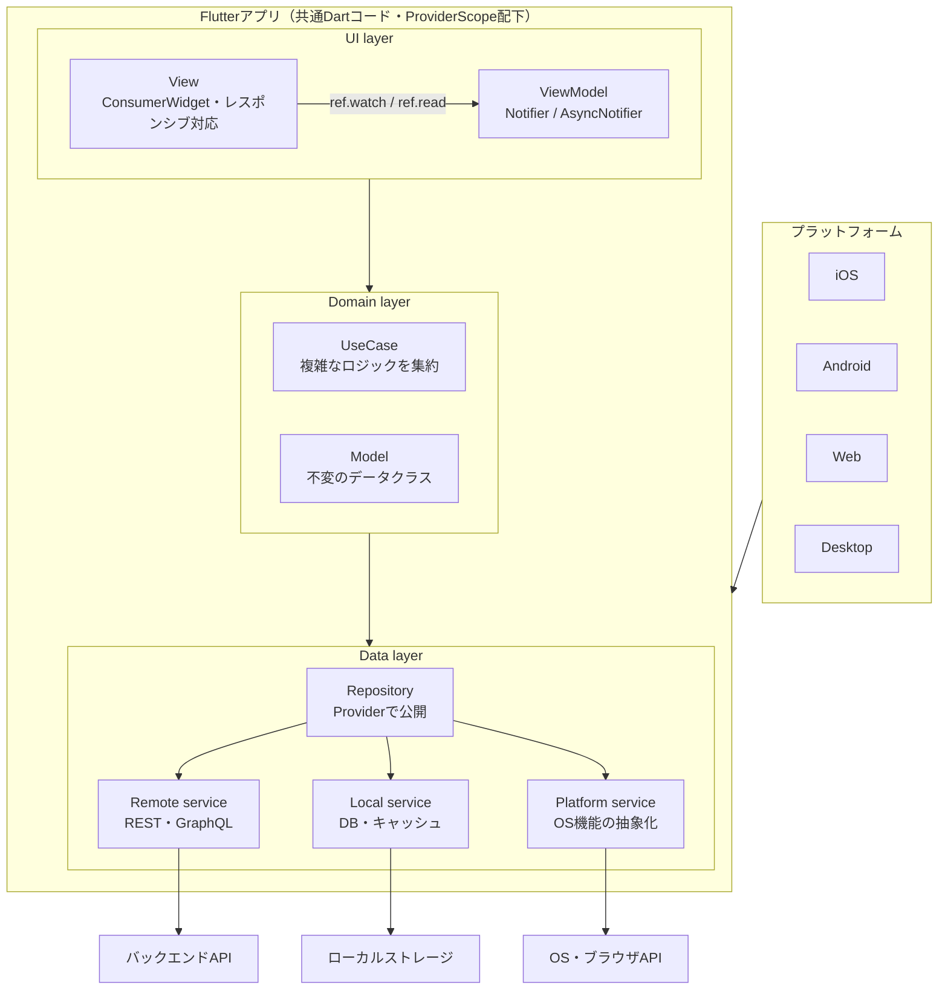

# Flutter モダンアーキテクチャまとめ

Flutter公式が推奨する「MVVM + レイヤードアーキテクチャ」を、マルチプラットフォーム (iOS・Android・Web・PC) 前提で整理したメモ。状態管理とDIはRiverpod（3系）を使う前提。

レイヤー構造そのものは公式ガイドと同じで、Riverpodが置き換えるのは「ViewModelの実装」と「依存の受け渡し（DI）」の2点。

## 1. 構成図



矢印は依存の向き。上から下への一方通行。層をまたぐ依存はすべて `ref` 経由で取得する（コンストラクタで手渡ししない）。

## 2. 各層の役割

| 層 | 要素 | Riverpodでの実装 | 役割 |
|---|---|---|---|
| UI | View | `ConsumerWidget` | Widgetのみ。`ref.watch` で状態を描画し、`ref.read(...notifier)` で操作を呼ぶだけ |
| UI | ViewModel | `Notifier` / `AsyncNotifier` | 画面の状態を持ち、Repository（またはUseCase）を呼ぶ。`BuildContext` やWidgetには依存させない |
| Domain | UseCase | `Provider` で公開する普通のクラス | 複数Repositoryをまたぐロジックや、複数ViewModelで重複するロジックを集約。必要になったら追加 |
| Domain | Model | 普通のDartクラス（freezedなど） | 不変のデータクラス。Riverpodには依存させない |
| Data | Repository | `Provider` で公開 | リモートとローカルを束ねてキャッシュ・リトライ・変換を担当。生のAPIレスポンスをModelに変換して返す |
| Data | Service | `Provider` で公開 | 外部との通信を薄くラップするだけ。状態は持たない |

## 3. 押さえるルール

- **依存は一方向**: 下の層は上の層を知らない。RepositoryやServiceからViewModelのproviderを参照しない
- **データも一方向**: 状態は下から上へ、イベントは上から下へ流れる
- **抽象に依存**: RepositoryとServiceはabstract classで定義し、providerの型も抽象側にする。テストやプラットフォーム差分は `overrides` で差し替える
- **providerは提供するクラスと同じファイルに置く**: 全providerを集めた `providers.dart` を作ると依存の向きが追えなくなる
- **Riverpodに触れるのはproviderの定義とUI layerだけ**: Repository・Service・Modelのクラス本体は素のDartにしておくと、ライブラリを変えても書き直しが少ない

### 最小の実装例

```dart
// data/repositories/item_repository.dart
abstract class ItemRepository {
  Future<List<Item>> fetchAll();
}

final itemRepositoryProvider = Provider<ItemRepository>(
  (ref) => ItemRepositoryImpl(ref.watch(apiServiceProvider)),
);

// ui/home/home_view_model.dart
final homeViewModelProvider =
    AsyncNotifierProvider<HomeViewModel, List<Item>>(HomeViewModel.new);

class HomeViewModel extends AsyncNotifier<List<Item>> {
  @override
  Future<List<Item>> build() => ref.watch(itemRepositoryProvider).fetchAll();

  Future<void> refresh() async {
    state = const AsyncLoading();
    state = await AsyncValue.guard(
      () => ref.read(itemRepositoryProvider).fetchAll(),
    );
  }
}

// ui/home/home_screen.dart
class HomeScreen extends ConsumerWidget {
  const HomeScreen({super.key});

  @override
  Widget build(BuildContext context, WidgetRef ref) {
    final items = ref.watch(homeViewModelProvider);
    return items.when(
      data: (list) => ItemList(list),
      loading: () => const CircularProgressIndicator(),
      error: (e, _) => ErrorView(onRetry: () =>
          ref.read(homeViewModelProvider.notifier).refresh()),
    );
  }
}
```

コード生成（`riverpod_generator` の `@riverpod`）を使うとprovider定義を省略できる。一人開発なら手書きでも十分で、どちらでも構造は変わらない。

### テストでの差し替え

```dart
final container = ProviderContainer.test(
  overrides: [itemRepositoryProvider.overrideWithValue(FakeItemRepository())],
);
```

### 公式サンプルとの対応

| 役割 | 公式サンプル | この構成 |
|---|---|---|
| ViewModelの状態通知 | `ChangeNotifier` + `ListenableBuilder` | `Notifier` / `AsyncNotifier` + `ref.watch` |
| 依存性注入（DI） | `package:provider` | Riverpodの `Provider` |

公式ガイドは「riverpodやflutter_blocでも同じように書ける」としており、強く推奨しているのはレイヤー分離・ViewModel・Repository・DIという構造のほう。

## 4. マルチプラットフォームで効いてくる点

1. **UIの出し分けは画面幅で行う**
   `Platform.isIOS` で分岐せず、`LayoutBuilder` などでブレークポイントを切る。ViewModelは全プラットフォーム共通で、Viewだけレイアウトを変える。
2. **プラットフォーム差分はPlatform serviceに閉じ込める**
   interfaceを1つ定義して、条件付きimportで実装を切り替え、providerからは抽象型で公開する。`dart:io` はWebで使えないので、UIやViewModelから直接importしない。
3. **ストレージはWebが別物**
   ファイルシステムもSQLiteもそのままでは使えない。Web対応のDBパッケージ（driftなど）を選ぶか、Local serviceで実装を分ける。
4. **ルーティングはURL前提**
   Webのアドレスバーとディープリンクのために go_router などの宣言的ルーティングにする。`GoRouter` もproviderとして公開すると、ログイン状態などを `ref` で見てリダイレクトできる。
5. **入力手段の違い**
   PCとWebはマウスホバー、キーボードショートカット、右クリック、ウィンドウリサイズに対応する。

## 5. フォルダ構成例

```
lib/
├── main.dart                      # ProviderScope でアプリ全体を包む
├── app.dart                       # ConsumerWidget。MaterialApp.router
├── ui/
│   ├── core/                      # 共通Widget・テーマ・ブレークポイント
│   └── home/
│       ├── home_screen.dart       # ConsumerWidget
│       ├── home_view_model.dart   # Notifier とそのprovider
│       └── home_state.dart        # 画面状態クラス（複雑になったら）
├── domain/
│   ├── models/                    # Riverpod非依存
│   └── use_cases/                 # 必要になったら
├── data/
│   ├── repositories/
│   │   └── item_repository.dart   # abstract + 実装 + provider
│   └── services/
│       ├── api/
│       ├── local/
│       └── platform/              # interface + _io.dart / _web.dart + provider
├── routing/
│   └── router.dart                # GoRouter をproviderとして公開
└── l10n/                          # ARBファイル（多言語対応）
```

`ui` は機能単位、`data` は種類単位で切る。Repositoryが複数の画面から共有されやすいため。

コード生成を使う場合は各ファイルの隣に `*.g.dart` が生成される。
